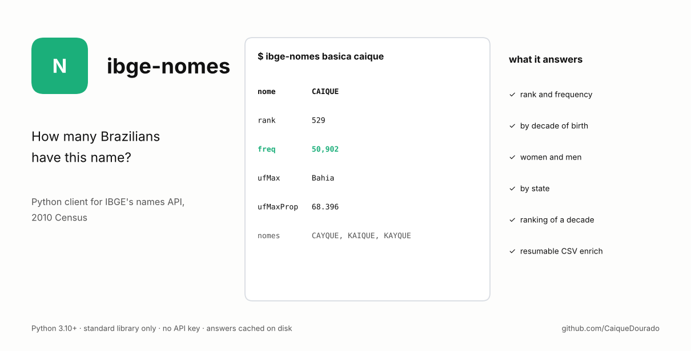
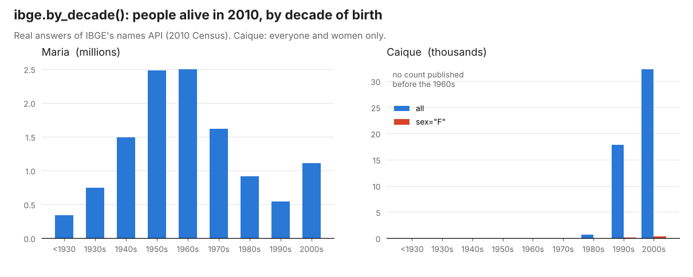
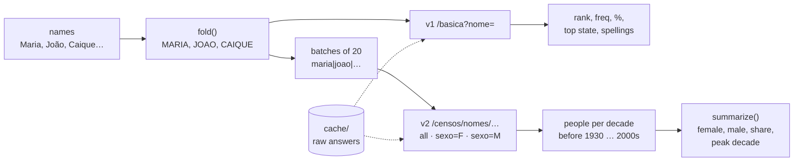

# ibge-nomes

[Português](README.pt-BR.md)

[](https://github.com/CaiqueDourado/ibge-nomes/actions/workflows/test.yml)




Python client for **IBGE's names API**, the public service that answers how many Brazilians had each first name in the **2010 Census**: rank, frequency, the state where the name is most common, how many are women and men, and in which decade they were born. Standard library only, no key needed.

```text
$ ibge-nomes basica caique
{"rank": 529, "nome": "CAIQUE", "freq": 50902, "percentual": 0.0278, "ufMax": "Bahia",
 "ufMaxProp": "68.3960", "regiao": 0, "sexo": "", "nomes": "CAYQUE,KAIQUE,KAYQUE"}
```

It began as the C# routine that enriched the 172,000 names of the site nomessobrenomes.com in 2023. That routine only called the basic endpoint, with no sex or region filter, so two columns came back empty for every name. This rewrite covers all the endpoints and was used to fill them in the [Brazilian names dataset](https://github.com/CaiqueDourado/brazilian-names-surnames).



*Real answers of the API: Maria peaked among people born in the 1950s and 1960s; Caique barely existed before the 1990s. `tools/make_figure.py` draws it.*



## Install

```bash
pip install "ibge-nomes @ git+https://github.com/CaiqueDourado/ibge-nomes"
# Windows: also pip install truststore (some government servers send incomplete certificate chains)
```

## Use

```python
from ibge_nomes import IbgeNomes, summarize

ibge = IbgeNomes(cache="cache")          # raw answers kept on disk: reruns cost no calls

ibge.basic("Caique")                     # v1: rank, freq, percentual, ufMax, ufMaxProp, nomes
ibge.by_decade(["Maria", "João"])        # v2: {"MARIA": {"before_1930": ..., "1930s": ..., "2000s": ...}, "JOAO": {...}}
ibge.by_decade(["Maria"], sex="F")       # only women; locality="33" for a state (IBGE code)
ibge.by_state("Caique")                  # v2 groupBy=UF: frequency and proportion per state
ibge.ranking(decade=1990, sex="M")       # most common names of a decade

names = ["Maria", "Andrea"]
total, women, men = (ibge.by_decade(names, sex=s) for s in (None, "F", "M"))
summarize(total["ANDREA"], women.get("ANDREA"), men.get("ANDREA"))
# {"female": ..., "male": ..., "share_female": ..., "peak_decade": ..., "born_before_1930": ..., ...}
```

Command line:

```bash
ibge-nomes basica caique
ibge-nomes decadas maria joao --sexo F
ibge-nomes estados caique
ibge-nomes ranking --decada 1990
ibge-nomes --cache cache enrich nomes.csv --column name --out nomes_ibge.csv   # resumable
ibge-nomes probe caique            # raw answer of every endpoint, to check the API format
```

## The API

| Endpoint | What it answers | Method |
|---|---|---|
| `v1/censos/nomes/basica?nome=` | rank, frequency, % of the population, state with the highest proportion, related spellings | `basic` |
| `v2/censos/nomes/<n1\|n2>?sexo=&localidade=` | people born per decade, for several names in one call | `by_decade` |
| `v2/censos/nomes/<nome>?groupBy=UF` | frequency and proportion per state | `by_state` |
| `v2/censos/nomes/ranking?decada=&sexo=&localidade=` | most common names | `ranking` |

Base URL `https://servicodados.ibge.gov.br/api`, documentation at [servicodados.ibge.gov.br/api/docs/nomes](https://servicodados.ibge.gov.br/api/docs/nomes).

Things worth knowing:

- **Counts are per spelling.** Caique 50,902, Kaique 43,883, Cayque 475. `nomes` in the basic answer only links related spellings.
- **First names only.** The Census counted first names, so compound names ("Maria Júlia") have no data.
- **Missing names.** Names IBGE has no data for are simply not returned; the client treats them as no data, not as an error.
- **Accents are ignored.** The client sends names in upper case without accents (`fold`) and matches answers the same way.
- **Decades without data are missing.** Caique has no count before 1960; `by_decade` leaves those decades out (zero or too few people).
- **The ranking's decade is the year it ends.** `ranking(decade=1990)` lists people born in [1980, 1990[.
- **Be gentle.** The default waits 0.2 s between calls and puts 20 names in each v2 call. A batch the server refuses is retried one name at a time.

## Limits

- The data is the 2010 Census. Names given after 2010 are not there.
- The API's answer format is not versioned beyond v1/v2. If a call starts failing, `ibge-nomes probe` prints the raw answers.

Article: [Enriching sign-up data with open APIs](https://github.com/CaiqueDourado/articles/blob/main/open-apis/README.md): what this API tells about a sign-up list, and how far a first name goes.

Related: [brazilian-names-surnames](https://github.com/CaiqueDourado/brazilian-names-surnames) (the dataset built with it), [municipios-e-estados-do-brasil](https://github.com/CaiqueDourado/municipios-e-estados-do-brasil) (IBGE codes for `localidade`), [PtBr.Text](https://github.com/CaiqueDourado/PtBr.Text).

MIT License. The data belongs to IBGE.
