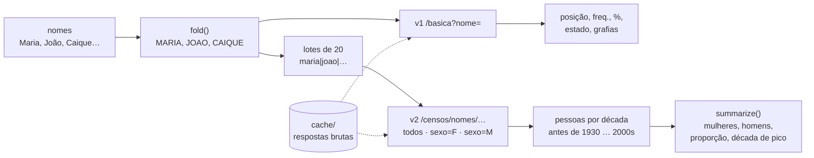

# ibge-nomes

[English](README.md)

[](https://github.com/CaiqueDourado/ibge-nomes/actions/workflows/test.yml)


Cliente Python da **API de nomes do IBGE**, o serviço público que responde quantos brasileiros tinham cada primeiro nome no **Censo 2010**: posição, frequência, estado onde o nome é mais comum, quantos são mulheres e homens e em que década nasceram. Só biblioteca padrão, sem chave.

```text
$ ibge-nomes basica caique
{"rank": 529, "nome": "CAIQUE", "freq": 50902, "percentual": 0.0278, "ufMax": "Bahia",
 "ufMaxProp": "68.3960", "regiao": 0, "sexo": "", "nomes": "CAYQUE,KAIQUE,KAYQUE"}
```

Começou como a rotina em C# que enriqueceu os 172 mil nomes do site nomessobrenomes.com em 2023. Aquela rotina só chamava o endpoint básico, sem filtro de sexo nem de região, então duas colunas voltaram vazias para todos os nomes. Esta reescrita cobre todos os endpoints. Foi com ela que essas colunas foram preenchidas na [base de nomes e sobrenomes](https://github.com/CaiqueDourado/nomes-e-sobrenomes-brasil).


*Respostas reais da API: as Marias vivas em 2010 nasceram sobretudo nos anos 50 e 60; Caique quase não existia antes dos anos 90. O gráfico é feito por `tools/make_figure.py`.*



## Instalação

```bash
pip install "ibge-nomes @ git+https://github.com/CaiqueDourado/ibge-nomes"
# Windows: instale também o truststore (alguns servidores do governo mandam a cadeia de certificados incompleta)
```

## Uso

```python
from ibge_nomes import IbgeNomes, summarize

ibge = IbgeNomes(cache="cache")          # guarda as respostas em disco: rodar de novo não gasta chamadas

ibge.basic("Caique")                     # v1: rank, freq, percentual, ufMax, ufMaxProp, nomes
ibge.by_decade(["Maria", "João"])        # v2: {"MARIA": {"before_1930": ..., "1930s": ..., "2000s": ...}, "JOAO": {...}}
ibge.by_decade(["Maria"], sex="F")       # só mulheres; locality="33" para um estado (código IBGE)
ibge.by_state("Caique")                  # v2 groupBy=UF: frequência e proporção por estado
ibge.ranking(decade=1990, sex="M")       # nomes mais comuns de uma década
```

Linha de comando:

```bash
ibge-nomes basica caique
ibge-nomes decadas maria joao --sexo F
ibge-nomes estados caique
ibge-nomes ranking --decada 1990
ibge-nomes --cache cache enrich nomes.csv --column name --out nomes_ibge.csv   # retoma de onde parou
ibge-nomes probe caique            # resposta bruta de cada endpoint, para conferir o formato da API
```

## A API

| Endpoint | O que responde | Método |
|---|---|---|
| `v1/censos/nomes/basica?nome=` | posição, frequência, % da população, estado com maior proporção, grafias relacionadas | `basic` |
| `v2/censos/nomes/<n1\|n2>?sexo=&localidade=` | nascidos por década, para vários nomes numa chamada | `by_decade` |
| `v2/censos/nomes/<nome>?groupBy=UF` | frequência e proporção por estado | `by_state` |
| `v2/censos/nomes/ranking?decada=&sexo=&localidade=` | nomes mais comuns | `ranking` |

URL base `https://servicodados.ibge.gov.br/api`, documentação em [servicodados.ibge.gov.br/api/docs/nomes](https://servicodados.ibge.gov.br/api/docs/nomes).

Bom saber:

- **A contagem é por grafia.** Caique 50.902, Kaique 43.883, Cayque 475. O campo `nomes` da resposta básica só liga as grafias relacionadas.
- **Só primeiro nome.** O Censo contou primeiros nomes, então nomes compostos ("Maria Júlia") não têm dado.
- **Nomes ausentes.** Nomes sem dado no IBGE simplesmente não voltam; o cliente trata isso como falta de dado, não como erro.
- **Acentos são ignorados.** O cliente manda o nome em maiúsculas sem acento (`fold`) e casa a resposta do mesmo jeito.
- **Décadas sem dado ficam de fora.** Caique não tem contagem antes de 1960; `by_decade` omite essas décadas (zero ou poucas pessoas).
- **A década do ranking é o ano em que ela termina.** `ranking(decade=1990)` traz quem nasceu em [1980, 1990[.
- **Com calma.** Por padrão espera 0,2 s entre chamadas e põe 20 nomes em cada chamada v2. Um lote recusado pelo servidor é refeito nome a nome.

## Limites

- Os dados são do Censo 2010; nomes dados depois de 2010 não aparecem.
- O formato da resposta não tem versão além de v1/v2. Se uma chamada começar a falhar, `ibge-nomes probe` mostra as respostas brutas.

Relacionados: [nomes-e-sobrenomes-brasil](https://github.com/CaiqueDourado/nomes-e-sobrenomes-brasil) (a base feita com ele), [municipios-e-estados-do-brasil](https://github.com/CaiqueDourado/municipios-e-estados-do-brasil) (códigos do IBGE para `localidade`), [PtBr.Text](https://github.com/CaiqueDourado/PtBr.Text).

Licença MIT. Os dados são do IBGE.
